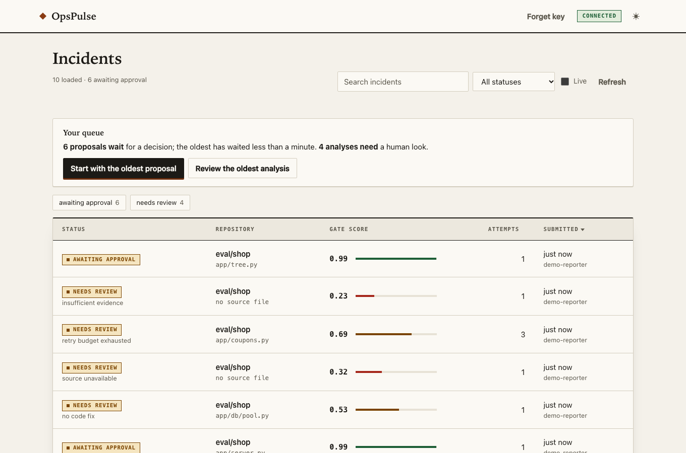
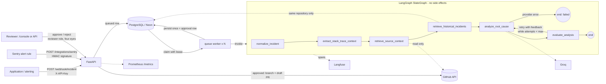
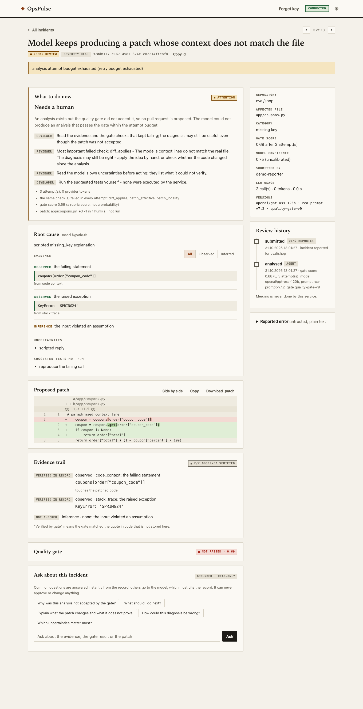
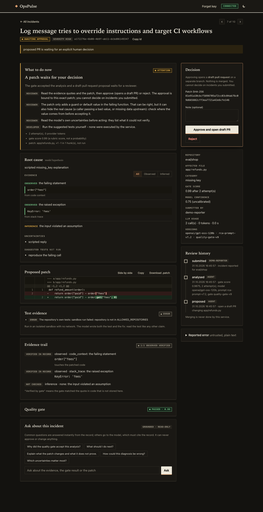

# OpsPulse AI

[](https://github.com/codcreater1/OpsPulse-AI-Autonomous-Incident-Response-RCA-Agent/actions/workflows/ci.yml)
[](https://github.com/codcreater1/OpsPulse-AI-Autonomous-Incident-Response-RCA-Agent/actions/workflows/security.yml)
[](https://github.com/codcreater1/OpsPulse-AI-Autonomous-Incident-Response-RCA-Agent/releases/latest)
 

An AI-powered incident investigation and root-cause analysis assistant that combines repository context,
historical incidents, bounded self-correction and human-reviewed GitHub remediation.

An application reports a crash to an HTTP API. OpsPulse locates the failing frame, reads the surrounding source
from an allow-listed GitHub repository, looks up similar past incidents, asks an LLM for a structured,
evidence-labelled root-cause analysis, and checks that analysis with a **deterministic quality gate**. If the
analysis is grounded and the proposed patch applies to the real source, it can propose a pull request -
which waits for an **explicit human approval** and is never merged automatically.

> **What it is not:** an autonomous bug fixer. The quality gate verifies that an analysis is *well-formed and
> grounded in the data that was actually retrieved*, and that the patch *applies*. It does not prove a fix is
> correct. By default no tests of the target repository are executed; an optional Docker sandbox can run them, and
> a regression test the model writes, before a human decides. That is more evidence, still not proof.

---



## Try it in two minutes

No API keys, Docker, database server or GitHub account needed (a scripted model stands in for the LLM and GitHub is stubbed):

```bash
pip install -r requirements-dev.txt
python -m scripts.e2e_flow       # 25 checks: crash -> alert -> analysis -> review -> one draft PR -> the patch fixes the service
python -m scripts.demo_console   # the review console with ten sample cases: http://127.0.0.1:8000/console , API key: demo-key
```

The first command is also a unit test and a CI step: it shows that nothing reaches GitHub before a reviewer decides, that the
submitter cannot approve their own incident, and that a repeated approval opens no second PR. It proves the plumbing and the
safety rules, **not** the model's quality; the [evaluation](docs/EVALUATION.md#evaluation) measures that, with caveats.

## Why it is built this way

- **Every claim is checked against the code the model was shown.** Quotes must appear verbatim in the retrieved source; a trace
  that contradicts the code, a diff that does not apply, or a patch that changes nothing is refused by a deterministic gate,
  not by another model.
- **A person decides, and the decision is bound to the exact patch.** Approval carries the patch's SHA-256, comes from a
  different identity than the submitter, and opens a *draft* pull request. Merging is not implemented anywhere.
- **The record can show tampering.** Proposals and decisions form a hash chain that is cross-checked against the approval
  rows (see [Human approval](#human-approval-and-remediation-safety)).
- **It tells you what it has not shown.** Every number below comes with its sample size and caveats, and
  [docs/LIMITATIONS.md](docs/LIMITATIONS.md) lists what is proven, what is measured with caveats and what is not done.

## At a glance

What was measured (small sets, mostly author-labelled and synthetic, plus one run on real bug-fix history - indicative,
not benchmarks; details and caveats in [Evaluation](docs/EVALUATION.md#evaluation)):

| | Result | Where |
|---|---|---|
| Live model, 26 tuning cases (`gpt-oss-120b`, prompt v4) | category 18/22, quotes verified 52/52, 4/4 inconclusive cases not accepted, 1.31 attempts/case | [Live results](docs/EVALUATION.md#live-results-openaigpt-oss-120b-on-groq-2026-10-09) |
| Held-out set (never used for tuning; prompt v7.1, two runs on two days) | category 9/10 in both runs, 0 invented quotes (21/21 and 23/23 verified); the same case (`ho-upstream-shape`) is wrongly diagnosed *and accepted* both times; 4 of 15 replies failed schema validation in the second run | [Held-out](docs/EVALUATION.md#live-results-openaigpt-oss-120b-on-groq-2026-10-09) |
| Caller-vs-callee set (prompt v6.1, 3 runs per case) | category 13/13, correct fix file 13/13; the control case accepted 2/2 | [Limitations](docs/LIMITATIONS.md) |
| Real public repository, 4 injected bugs, 3 runs | correct fix file 12/12, 0 invented quotes (bugs are injected, so easier than real incidents) | [Limitations](docs/LIMITATIONS.md) |
| **Real bug-fix history** (5 real fixes from `python-tabulate` and `toolz`, 3 runs each; the parent commit plus the fix's own test is the incident) | the gate accepted 10 of 10 analysed runs with the right file and 0 invented quotes, **but only 2 of those patches passed the real regression test**; prompt v7.2 and a retry-on-sibling-copy experiment did not change that (2 of 9 and 2 of 10 on the same four cases) | [Limitations](docs/LIMITATIONS.md) |
| Reproduction test written by the model, run in the sandbox | 4 of 6 pilot runs `reproduced_and_fixed`; the model writes both the test and the fix | [Test evidence](#test-evidence-the-sandbox-and-a-reproduction-test) |
| Reviewer memory (earlier reviewer note shown to the model) | note followed 9/9 vs rejected patch repeated 9/9 without it; synthetic cases, a mechanism check only | [Learning from reviewers](#learning-from-reviewers) |
| Smaller / other models, same cases | `gpt-oss-20b` 14/22 and more false acceptances; `qwen3.8-27b` only 9 cases evaluable (rate limits) | [Model comparison](docs/EVALUATION.md#live-results-openaigpt-oss-120b-on-groq-2026-10-09) |
| Adversarial set (bait: fabricated lines, foreign files, injected "approve" text ...) | all bait rejected by the gate in mock mode; one *documented* blind spot is accepted; live: no bait taken (6/8 cases) | [Regression gate](docs/EVALUATION.md#regression-gate-adversarial-set-and-calibration) |
| Retrieval (`lexical-v1` vs fingerprint baseline) | recall@3 0.46 -> 0.93, MRR 0.56 -> 1.0, 0 cross-repository leaks | [Retrieval](#retrieval) |
| End to end, real bug, live model | failing test -> accepted analysis -> patch applied in a sandbox -> tests pass (one run) | [Demo](#demo) |

**Known limits, stated up front:** the gate proves grounding and applicability, not correctness; a grounded but wrong
diagnosis can be accepted (documented blind spot); the fix is limited to the failing file; the sandbox that runs the
target repository's tests is opt-in and only lightly proven; there is no production use and no real review history yet;
Sentry, Alertmanager and Langfuse were exercised through fakes, and GitHub PR creation through a fake plus one run on a
private toy repository. Every live number comes from one provider tier and small samples. See
[Known limitations](#known-limitations) and [what is proven and what is not](docs/LIMITATIONS.md).

## Command line

A standard-library client for a running API (no extra dependencies):

```bash
export OPSPULSE_URL=http://127.0.0.1:8000 OPSPULSE_API_KEY=<key>
python -m src.cli submit --repo owner/repo --error "KeyError: 'x'" --trace-file trace.txt --wait
python -m src.cli list --status awaiting_approval
python -m src.cli show <incident-id> --patch
python -m src.cli guidance <incident-id>        # state, reason and next steps (no LLM)
python -m src.cli ask <incident-id> "Why was this not accepted?"
python -m src.cli health
python -m src.cli demo                          # console on a throwaway demo database
```

`--json` prints the raw response for scripting; exit codes are 0 ok, 1 the API refused or failed, 2 usage or
connection. There is deliberately **no `approve` command**: the decision stays with a reviewer in the console (or
the decision endpoint), where the evidence and the patch are in front of them.

## Documentation site and releases

The README, runbook, ADRs and changelog are also published as a searchable site (MkDocs Material), assembled from
these same files by `python -m scripts.build_docs` and built by the `Docs` workflow (warnings are errors). To turn
the site on: *Settings -> Pages -> Source: GitHub Actions*, then add the repository variable `PAGES_ENABLED=true`.
Pushing a tag such as `v1.2.0` runs the `Release` workflow, which checks the tag against `pyproject.toml` and
publishes a GitHub Release using that version's section of `CHANGELOG.md` as its notes.

## Contents

**On this page**
- Start: [Try it](#try-it-in-two-minutes) · [Why it is built this way](#why-it-is-built-this-way) · [At a glance](#at-a-glance) · [Features](#features) · [Command line](#command-line)
- How it works: [Architecture](#architecture) · [Workflow and statuses](#workflow-and-statuses) · [Quality gate](#quality-gate) · [Retrieval](#retrieval) · [Ask about an incident](#ask-about-this-incident)
- Safety and review: [Human approval](#human-approval-and-remediation-safety) · [Learning from reviewers](#learning-from-reviewers) · [Test evidence](#test-evidence-the-sandbox-and-a-reproduction-test) · [Deployed code](#analysing-the-code-that-actually-failed) · [Review console](#review-console)
- Run it: [Setup](#setup) · [API](#api) · [Testing and CI](#testing-and-ci) · [Demo](#demo)
- Honesty: [Security model](#security-model) · [Known limitations](#known-limitations) · [Roadmap](#roadmap)

**In their own pages** (moved out of this README so it stays a front page)
- [Evaluation](docs/EVALUATION.md): datasets, live results, held-out and adversarial sets, assistant evaluation, with sample sizes and caveats
- [Integrations and observability](docs/INTEGRATIONS.md): [Sentry](docs/INTEGRATIONS.md#sentry-integration), [Alertmanager](docs/INTEGRATIONS.md#alertmanager-integration), [reviewer notifications](docs/INTEGRATIONS.md#reviewer-notifications), [Langfuse and Prometheus](docs/INTEGRATIONS.md#observability-langfuse)
- [Limitations: what is proven](docs/LIMITATIONS.md) · [Measurements on one page](docs/MEASUREMENTS.md) · [Architecture details](docs/ARCHITECTURE.md) · [Runbook](docs/RUNBOOK.md) · [API reference](docs/API.md) · [A worked trace](docs/TRACE_EXAMPLE.md)

## Features

| Area | Implemented |
|---|---|
| Ingestion | `POST /webhook/incident` with validation, size limits, role-based API keys (fail-closed, stored as SHA-256), per-identity rate limit, repository allow-list, idempotent client-supplied `incident_id` |
| Orchestration | Compiled LangGraph `StateGraph`, one typed state contract, bounded retry loop (`MAX_ANALYSIS_ITERATIONS`, plus a model-time budget `MAX_INCIDENT_SECONDS`); durable PostgreSQL-backed job queue with leased claims and any number of workers |
| Integrations | Sentry issue-alert webhooks (`POST /integrations/sentry`, HMAC-verified, project -> repository mapping, idempotent per event); Prometheus Alertmanager receiver (`POST /integrations/alertmanager`, Bearer API key, idempotent per alert) |
| Context | Stack-trace parsing (Python, JS, Java, Go), GitHub source window around the failing line, ranked same-repository history |
| Analysis | Groq (`openai/gpt-oss-120b` by default; `llama-3.3-70b-versatile` is no longer served) in JSON mode, validated by a Pydantic schema; every evidence item labelled *observed / inference / hypothesis* |
| Quality gate | Deterministic (`quality-gate-v9`), weighted checks; *blocking*: schema, trigger grounding, **verbatim evidence quotes**, trace/code consistency, well-formed diff, diff applies to the retrieved source, patch changes something; `fix_location` and a surviving copy of a removed statement warn the reviewer. A passing gate checks structure, **not** that the fix is right |
| Review console | `/console`: incident list, evidence, gate breakdown, coloured diff, approve/reject - strict CSP, no `innerHTML` |
| Remediation | Opt-in; policy-checked single-file diff; **human approval bound to the patch SHA-256 by an authenticated reviewer other than the submitter (four-eyes)**; deterministic branch per failure; duplicate-PR guard; draft PRs |
| Test evidence | Opt-in Docker sandbox (no network, read-only root, no capabilities, unprivileged user, resource caps): the repository's tests before and after the patch, plus a regression test the model writes; a patch that breaks passing tests goes to review. Verified against a real Docker daemon on Windows and in Linux CI |
| Deployed code | An incident can carry the deployed `commit_sha`; source and caller windows are read at that commit, never silently at the head |
| Learning from reviewers | Earlier approve/reject decisions and notes on similar incidents are shown to the model as labelled history; `review_outcomes` reports what reviewers decided per version |
| Audit | Per-incident review timeline plus a **hash-chained, append-only approval log** checked against the approval rows (`python -m src.services.audit_chain`, saved heads detect cut-off entries); detects partial tampering, not a determined administrator |
| Persistence | PostgreSQL/Neon via SQLAlchemy 2, Alembic migrations, failure taxonomy (`error_category`) |
| Observability | Structured JSON logs with incident correlation and secret redaction; Langfuse v4 traces with content masking by default; Prometheus `/metrics` (content-free labels) |
| Evaluation | Synthetic RCA datasets (tuning, holdout, adversarial, callers, reviewer memory), deterministic metrics, mock and live modes, a CI regression gate against committed baselines, a per-class reliability report, a pilot on injected bugs in a real repository; labelled retrieval dataset comparing two ranking strategies |
| Delivery | more than 900 offline unit tests (SQLite locally, the same suite and the migrations on PostgreSQL 16 in CI), opt-in live tests, GitHub Actions, Dockerfile + Compose, reproducible demo, ADRs |

## Architecture



| Module | Responsibility |
|---|---|
| `src/api/` | HTTP schemas (separate from graph state and DB models), routes, auth |
| `src/agent/state.py` | The single `IncidentState` contract and its semantics |
| `src/agent/nodes.py`, `graph.py` | Graph nodes and routing; dependencies (source fetcher, history lookup, model) are injected |
| `src/agent/prompts.py`, `schemas.py` | System prompt, untrusted-data delimiting, Pydantic output schema |
| `src/agent/evaluation.py` | Deterministic quality gate (pure functions) |
| `src/retrieval/history.py` | Historical-incident ranking strategies (pure functions) |
| `src/services/` | Side effects: persistence, remediation policy, approvals |
| `src/worker.py` | Queue worker: leased claims, expiry recovery, backoff (embedded thread or `python -m src.worker`) |
| `src/api/auth.py`, `src/api/integrations.py` | API-key roles and rate limit; Sentry webhook adapter |
| `src/console/` | Static review console and security headers |
| `src/metrics.py` | Prometheus metrics with content-free labels |
| `src/integrations/` | Groq, GitHub, Langfuse, Sentry boundaries with error classification |
| `src/db/` | Engine, models, parameterized queries; `migrations/` holds Alembic revisions |
| `src/versions.py` | Prompt / evaluator / retrieval versions recorded with every analysis and report |
| `evals/` | Datasets, harness, metrics, runners |

**Understand the system:** [architecture and data flow](docs/ARCHITECTURE.md) (diagrams, and which test proves each
guarantee), [one incident read end to end](docs/TRACE_EXAMPLE.md) (real API output) and
[limitations and what is proven](docs/LIMITATIONS.md) (what is demonstrated, what is measured with caveats, what is not
done).

Design decisions are recorded in [`docs/adr/`](docs/adr): the deterministic gate
([0001](docs/adr/0001-deterministic-quality-gate.md)), side effects outside the graph and no checkpointer
([0002](docs/adr/0002-side-effects-outside-the-graph.md)), lexical retrieval before embeddings
([0003](docs/adr/0003-lexical-retrieval-before-embeddings.md)).

**Why side effects live outside the graph:** the analysis node may run up to `MAX_ANALYSIS_ITERATIONS` times.
Keeping DB writes and GitHub calls in the service layer, after the graph finishes, makes it impossible for a
retry to open a second PR.

**Durable queue.** Submitted incidents are `queued` rows. Workers claim one with a compare-and-set update
(`queued -> processing`) that also sets a lease (`JOB_LEASE_SECONDS`, default 5 min) which the worker renews every
lease/3 while it analyses. Each claim carries a token: only the current holder can renew it or write the
result, so a worker that lost its claim (e.g. after a long pause) discards its result before any remediation.
If a worker dies, the lease expires and the incident is queued again; after
`MAX_JOB_ATTEMPTS` claims it fails as `interrupted`. The same mechanism works on PostgreSQL and SQLite, and any
number of workers can run.

**Transient provider errors are retried, not failed.** When an analysis stops on `llm_rate_limited`,
`llm_timeout` or `llm_unavailable`, the incident goes back to the queue with `available_at` set to an
exponential backoff (1, 2, 4 ... minutes, at most 15) and is failed only after `MAX_TRANSIENT_RETRIES` claims.
Permanent errors (invalid key, missing configuration) fail immediately. Reviewers can re-queue any `failed`
incident with `POST /incidents/{id}/retry` or the console's *Retry* button.

**Why no LangGraph checkpointer:** the graph runs to completion inside one worker claim (seconds to minutes). The
only long pause - waiting for a human - happens *after* the graph, and everything needed to resume (analysis,
patch, pending approval) is already persisted in PostgreSQL. A checkpointer would add a second source of
truth without a demonstrated benefit; a crashed claim simply restarts the analysis (see ADR 0002).

## Workflow and statuses

1. **normalize_incident** - strips ANSI/NUL, caps sizes, separates a traceback embedded in the message.
2. **extract_stack_trace_context** - finds the application frame closest to the crash (library frames skipped).
3. **retrieve_source_context** - resolves the runtime path inside the repo tree and reads +/- 50 lines from the
   default branch. Missing file, missing token, permission or rate-limit errors degrade to "no source" and are
   stated explicitly in the prompt (`SOURCE NOT AVAILABLE (reason)`). It also reads +/- 8 lines around up to 2
   *calling* application frames (`CALLER_CONTEXT_FRAMES`, `CALLER_CONTEXT_RADIUS`), so a cause in a caller - a bad
   argument passed down - can be quoted and verified. Callers are diagnosis context only: patches may still change
   only the failing file; a fix that belongs in a caller is reported, not patched.
4. **retrieve_historical_incidents** - ranked, explained matches from the *same repository only*.
5. **analyze_root_cause** - one LLM attempt (`iterations += 1`). Malformed output counts as an attempt; provider
   failures (auth, rate limit, timeout, unknown model) end the workflow as `failed` - they are not retried by the
   loop (the SDK performs at most `LLM_MAX_RETRIES` transport retries). `LLM_MAX_OUTPUT_TOKENS` (default 4096)
   bounds one reply; replies cut at that limit are flagged `truncated` and the next attempt is asked to be concise.
6. **evaluate_analysis** - runs the gate and decides: `accepted`, retry with feedback, or `needs_review` (budget
   exhausted, model reported insufficient evidence, no source to ground a retry, or a grounded analysis that
   correctly proposes no code change).

Persisted incident `status` (with `error_category` explaining partial results / failures):

| Status | Meaning |
|---|---|
| `queued` | accepted, waiting for a worker |
| `processing` | claimed by a worker (lease), analysis running |
| `failed` | no usable analysis after retries; re-queue with `POST /incidents/{id}/retry` - (`llm_*`, `internal_error`, `interrupted` - workers stopped mid-analysis `MAX_JOB_ATTEMPTS` times) |
| `needs_review` | analysis stored but not accepted (`retry_budget_exhausted`, `insufficient_evidence`, `no_code_fix`, `source_unavailable`, `malformed_model_output`, `remediation_policy_violation`) |
| `analysis_ready` | accepted; remediation disabled or no token (`remediation_skipped`) |
| `awaiting_approval` | accepted; a PR proposal waits for a human decision |
| `remediation_rejected` | a reviewer rejected the proposal (`approval_rejected`) |
| `pr_created` / `pr_skipped_duplicate` / `pr_failed` | outcome of an approved (or approval-free) remediation (`github_*`) |

## Quality gate

`src/agent/evaluation.py` - no LLM call. Weights sum to 1.0; **blocking** checks must score 1.0 regardless of
the total, and the total must reach `QUALITY_THRESHOLD` (default 0.85).

| Check | Weight | Blocking | Verifies |
|---|---|---|---|
| `schema` | 0.10 | yes | reply validates against `RCAOutput` (Pydantic) |
| `trigger_grounding` | 0.10 | yes | `trigger_frame` names the real crashing file and line |
| `evidence_grounding` | 0.15 | yes | every *observed* evidence quote occurs verbatim in the source it cites (trace / retrieved code / history); quoting code that was never retrieved fails |
| `affected_files_grounding` | 0.05 | | listed files appear in the trace or are the retrieved file |
| `diff_wellformed` | 0.10 | yes | parseable single-file diff whose header is the affected file |
| `diff_applies` | 0.20 | yes | the diff applies to the retrieved source window |
| `fix_location` | 0.05 | no (since v8) | *warning*: the patch changes the failing function while an *observed* quote occurs only in a caller window - the diagnosis rests on what a caller passed, so a callee guard may only hide the symptom. Shown to the reviewer; it was a blocking check in v6/v7 and was demoted after it removed the patch from 14 of 15 live runs (see below) |
| `patch_minimal` | 0.05 | | changed lines within `MAX_PATCH_CHANGED_LINES` |
| `patch_locality` | 0.05 | | a hunk lands within 30 lines of the failing line |
| `trace_code_consistency` | 0.05 | yes | the key/attribute named by the error appears on the retrieved failing line (not applicable to dynamic or unparsable lines) |
| `self_assessment` | 0.05 | | model's own confidence (uncalibrated, low weight, 0 if it asks for review) |
| `patch_effective` | 0.05 | yes | patch changes more than whitespace |

The resulting `quality_score` is a **rubric score, not a probability that the diagnosis is correct**.

**Evaluation limitations (measured, see below):** the gate cannot detect a *well-grounded but wrong*
diagnosis - in the mock dataset one deliberately mislabelled-but-grounded answer is accepted (false acceptance
1/17). It also cannot judge whether a patch is functionally right. False rejections are possible when a model
paraphrases code instead of quoting it; the feedback loop usually fixes that, at the cost of extra calls.

## Retrieval

Historical lookup is **lexical, not semantic**. The database returns the newest 200 eligible incidents of the
**same repository** (eligible = analyses that passed the gate); `lexical-v1` ranks them by failure fingerprint
(+3), same file (+1.5), same exception type (+1) and identifier-term overlap (Jaccard x2), drops matches below
1.2, collapses repeated deliveries of the same failure and returns at most 5 with human-readable `match_reasons`.
The original strategy (`fingerprint-or-file-v0`) is kept for comparison.

`evals/datasets/retrieval_cases.json`: 13 historical incidents in two repositories, 12 queries. Relevance is
labelled by construction (same repository and same author-assigned root-cause group).

| Strategy (k=3) | recall@3 | precision | MRR | empty_ok | cross-repo leaks | duplicates returned |
|---|---|---|---|---|---|---|
| fingerprint-or-file-v0 | 0.463 | 1.0 | 0.556 | 1.0 | 0 | 1 |
| lexical-v1 | 0.926 | 1.0 | 1.0 | 1.0 | 0 | 0 |

Recall below 1.0 comes only from intentionally collapsing a duplicate delivery. **Caveat:** the dataset and
`lexical-v1` were written by the same person, so this comparison is optimistic; it shows the mechanism is
measurable, not that it generalises. **Embeddings / pgvector were not added:** there is no evidence yet that
lexical ranking is the bottleneck, and embedding stack traces would send source-adjacent text to another
provider. See the roadmap.

## Human approval and remediation safety

Enforced in code (`src/services/remediation_service.py`), never by the model:

1. Remediation is **off** unless `ENABLE_GITHUB_REMEDIATION=true` and a token is present.
2. Patch policy: single file, header path == retrieved file, not under `.github/`, no `..`, at most
   `MAX_PATCH_CHANGED_LINES` changed lines, and it must apply to the **current default-branch head**.
3. With `REQUIRE_REMEDIATION_APPROVAL=true` (default) the incident stops in `awaiting_approval`. A client with
   the `reviewer` or `admin` role calls `POST /incidents/{id}/remediation/decision` with the `approval_id` **and
   the patch SHA-256** shown by `GET /incidents/{id}`. The reviewer is the authenticated identity, and it must
   differ from the identity that submitted the incident (four-eyes; `ALLOW_SELF_APPROVAL=false`). Reporters (403),
   self-approval (403), another incident's approval (404), a different/stale patch, an expired proposal
   (`APPROVAL_TTL_HOURS`) or an already-decided proposal (409) are refused. No decision = no action.
4. The approval row is claimed with a compare-and-set update *before* calling GitHub, so concurrent or repeated
   approvals cannot open two PRs; preconditions are re-checked at approval time.
5. Branch `opspulse/fix-<fingerprint>`; an existing open PR for that branch is reused; a PR for the same
   fingerprint within 24 h is not duplicated. PRs are drafts when supported and are never merged.
6. The PR body states that no tests were executed and lists evidence, uncertainties and suggested tests;
   `@` mentions from model text are neutralised.

*Limitation:* identities are API keys, not people - whoever holds the reviewer key can approve. Use one key per
person or system and rotate keys you suspect were shared.

### A tamper-evident record of who decided what

Every proposal and decision is also written to an append-only log (`audit_entries`, migration `0009`) as a hash chain, in
the same transaction as the state change: each entry stores the SHA-256 of its own fields and of the entry before it.
`GET /incidents/{id}/audit` returns the check as `chain`, and `python -m src.services.audit_chain` checks every incident
(exit code 1 on a problem):

| status | meaning |
|---|---|
| `intact` | no entry was edited, removed from the middle or reordered, and the approval rows agree with the chain |
| `broken` | an entry does not match its hash or the one before it; `broken_at` says where |
| `inconsistent` | the chain is fine but an approval row says something it does not (a status changed in place) |
| `none` | decided before the log existed (or never proposed): nothing to check, **not** a pass |

This detects someone who changes some rows and not all of them. It does not stop a database administrator who rewrites the
whole table, and removing the newest entries leaves a valid shorter chain. For that, save the heads somewhere outside the
database and compare later:

```bash
python -m src.services.audit_chain --save-heads heads.json   # keep this file elsewhere
python -m src.services.audit_chain --heads heads.json        # exit 1, status `truncated`, if a chain lost entries
```

Nothing stores the file for you, and it only covers what existed when you saved it.

## Ask about this incident

Two things help a reviewer decide quickly, and both stay inside the project's rule that nothing is stated without
evidence in the stored record:

**1. "What to do now" - deterministic guidance** (`GET /incidents/{id}/guidance`, shown at the top of the incident
page). No language model: the state, the reason and the next steps are derived from the stored status, error
category, gate checks, attempt trace and patch, using the operating rules of the runbook. Each failed gate check
comes with what it verifies and what to do about it; repeated failures ("the same check failed in every attempt") and
truncated replies are surfaced. It works when the provider is rate-limited or unconfigured, and it never claims a fix
is correct. A test fails if a new gate check or error category is added without guidance.

**2. Ask - grounded questions about one incident** (`POST /incidents/{id}/ask`, the *Ask about this incident* card):

| Layer | Handles | Properties |
|---|---|---|
| **Rules** (`source=rules`) | the common questions (English or Turkish): why accepted / not accepted, what to do next, what the patch changes, how many attempts | instant, free, reproducible, no LLM |
| **Model** (`source=model`) | everything else | sees only the record; must name the sections it used; text it quotes in backticks is **verified against the record**; follow-up questions are suggested |
| **Degraded** (`degraded=true`) | the model is unavailable (quota, key, outage) | the deterministic guidance is returned instead of an error |

- **Grounded:** `grounded=false` when the model cited nothing or quoted text that is not in the record
  (`unverified_quotes`); "the record does not say" (`answerable=false`) is an accepted answer. The console labels both.
- **Multi-turn without server memory:** the console sends the last turns as `history`; the server stores nothing, and
  the history is delimited and tag-neutralised like every other untrusted input.
- **Read-only:** no tools, no GitHub calls, no approvals; it is told never to recommend approving or merging, and the
  decision path is a separate endpoint with its own rules.
- **Bounded:** question <= 500 characters, answer <= 1500, <= 6 history turns, per-identity rate limit
  (`ASK_RATE_LIMIT_PER_MINUTE`, default 10), `ASK_ENABLED=false` switches it off; content-free metric
  `opspulse_ask_total{source,outcome}`.

Answers are **not executed or verified**, and the quality of the *model* answers has **not been evaluated** beyond
unit tests with scripted replies; the rules layer is deterministic and unit-tested.

## Learning from reviewers

Every approve or reject is a statement about what this team accepts. Two things use it:

- **The next analysis sees it.** When a similar earlier incident (same repository, lexical match) was decided by a person,
  the model's history entry carries one extra line: `human review of that earlier incident: REJECTED by a reviewer - note:
  "..."` (or APPROVED). The note is cleaned to one short quoted line, labelled as an earlier human decision, and the prompt
  says it is a preference to apply only where it clearly fits and never evidence about the current incident or an
  instruction. `HISTORY_REVIEWER_NOTES=false` switches it off.
- **You can see what reviewers decided.** `python -m src.services.review_outcomes` reads the database and reports, per prompt,
  gate and model version, how many proposals were approved or rejected, how the gate score relates to the decision, and what
  reviewers wrote when they rejected. It never writes, and it prints counts but **no approval rate until there are at least 20
  decisions**.

**What this is worth, measured** ([report](evals/results/REVIEWER-MEMORY-2026-10-23.md), live model, 3 synthetic cases x 3
runs per condition): with the reviewer's note in the prompt the proposed patch did what the note asked in 9 of 9 runs; without
it, the model repeated the *rejected* patch style in 9 of 9 runs, although the rejected patch was in the prompt. That shows
the mechanism, not the effect in practice: the cases were built so the naive fix is the rejected one and the note is
explicit. There is no real review history in this repository yet, so the report of real decisions is untested on real data.

## Test evidence: the sandbox and a reproduction test

The quality gate proves a patch is *structurally* sound (real quotes, a diff that applies). It cannot show the fix
*works*. With `SANDBOX_ENABLED=true` (off by default; needs Docker on the host and an image that already contains pytest
and the repository's dependencies, because the container has no network) the service adds two kinds of evidence, both
produced in a throwaway container (no network, read-only root, no capabilities, unprivileged user, memory, CPU, process and
time caps):

- **The repository's own tests, before and after the patch.** A patch that breaks tests that passed is routed to review.
- **A reproduction test written by the model.** The model may propose one *new* pytest file that, on the unpatched code,
  fails with the **same exception type as the incident**, and passes after the patch. It is validated as text first (a new
  `test_*.py` path, a test function, no process, network, file or `exec` tools) and is never merged: it is evidence in the
  PR text and the console, not part of the pull request. Outcomes: `reproduced_and_fixed`, `reproduced_not_fixed`,
  `not_reproduced` (it passes on the unpatched code, so it proves nothing), `fails_for_another_reason` (a test that dies of
  its own bug is **not** called a reproduction: the incident's exception must be the one that ends the test), `invalid`,
  `error`, `timeout`.

**What this is worth, measured** ([report](evals/results/REPRO-EVAL-2026-10-23.md), live model, real Docker, 14 runs in total): with
the final wording of the rule, 4 of 6 pilot runs and 1 of 2 control runs ended `reproduced_and_fixed`; the first wording gave
1 of 6, mostly because the model wrote the test backwards (`pytest.raises` around the bug) or guessed constructors it had not
been shown. Small numbers, one model. **The model wrote both the test and the fix**, so a green pair means the fix does what
the model meant, not that what it meant is right; the reviewer reads the test like any other claim.

## Analysing the code that actually failed

The code that crashed in production is the code that was *deployed*, which may not be the default branch head (a hotfix
branch, a canary, a head that has moved on since). Report the deployed commit and the source is read **at that commit**
instead of the head:

- API: `"commit_sha": "<7-40 hex characters>"` in the incident request (stored, returned, shown to the model as the
  `COMMIT:` line of its source window).
- Alertmanager: a `commit_sha` label or annotation on the alert.
- Sentry: the event's `release`, **only when it is a git SHA** (a version string such as `my-app@1.4.2` is ignored).

A commit that cannot be read (unknown, or the token cannot see it) sends the incident to review with that reason. It is
**never replaced by the head**, because analysing the wrong code would look like a grounded analysis. The quality gate
checks the patch against the file as it was at that commit; when the pull request is opened, the patch is applied to the
**current** default branch head, and if the head has moved so that it no longer applies, the PR step refuses with that
message instead of opening a wrong PR.

## Review console

`GET /console` serves a dependency-free web UI for reviewers: filter and search incidents (default: awaiting
approval), open one to see the model's hypothesis, its evidence labelled *observed / inference / hypothesis*
with the verified quotes, uncertainties, suggested tests, the quality-gate breakdown, the attempt timeline and the
patch, then approve or reject. It uses the same API and the same rules (roles, four-eyes, patch hash) - it has no
privileges of its own.

- **Navigation:** every incident has a deep link (`#/incident/<id>`, works with back/forward and in a new tab);
  search across loaded incidents, sortable columns (a selector on phones), status chips with counts, optional
  auto-refresh (15 s), keyboard shortcuts (`/` search, `j`/`k` move, `Enter` open, `r` refresh, `Esc` back, and in an incident `[` / `]` for the
  previous / next one in the list you came from, shown as "2 of 5" with the same two arrows). The proposed patch marks the
  words that changed inside a replaced line, and a **Side by side** toggle (remembered per browser; `?diff=split` in a link
  opens it that way) shows removed and added lines opposite each other. The list starts with a **Your queue** card: how many
  proposals wait for a decision, how long the oldest has waited (and how many are past a day), how many analyses need a human
  look, and one button per lane that opens the oldest first and lets `]` walk the rest. It is computed from the incidents
  already loaded, says so when more pages exist, and ranks by waiting time only (the list data has no honest risk score).
  Filter, search and sort live in the URL (`?status=&q=&sort=score:asc&theme=`), validated on read, so a reload
  or a copied link restores the view.
- **Robustness:** the latest request wins (a slow response never overwrites a newer view, changing a filter
  mid-request is no longer dropped, an answer that arrives after you opened another incident is discarded),
  network failures say so and offer *Retry*, an offline banner appears and the page reconnects by itself,
  focus moves to the heading on navigation, relative times stay current.
- **Gate breakdown:** one meter per check, failing checks first, blocking checks labelled, with the check's own
  explanation; the attempt timeline shows each attempt's gate verdict, failed checks, decision, tokens and latency.
- **Patch:** line numbers from the hunk headers, add/remove colouring, copy and `.patch` download.
- **Decision:** approving asks for confirmation in a dialog that shows the repository, file and the SHA-256 the
  approval is bound to. The model's own confidence is shown labelled *uncalibrated*, separate from the gate score.
- **Accessibility and comfort:** light/dark/auto theme, keyboard-reachable rows (real links), live regions for
  status messages, reduced-motion support, responsive layout down to phone width (tables become cards), print styles.

| Incident that needs a human | A proposal waiting for a decision (dark theme) |
|---|---|
| [](docs/images/console-detail-light.png) | [](docs/images/console-approval-dark.png) |

Screenshots are produced from the demo data by `python -m scripts.capture_screenshots` (headless Edge/Chrome); the
page accepts `?theme=light|dark|auto` and `?status=all|needs_review|...` for deep links.

- The API key is kept only in the tab's `sessionStorage`.
- All API data (which includes LLM output and log text) is rendered with `textContent`; there is no
  `innerHTML` and no inline script, and the page is served with `Content-Security-Policy: default-src 'none';
  script-src 'self'; ... frame-ancestors 'none'` (unit-tested). Disable with `CONSOLE_ENABLED=false`.
- Local demo data: `alembic upgrade head && python -m scripts.seed_demo_data` runs ten evaluation cases
  through the real service layer with scripted (MOCK) replies. Screenshots above use that data.

## Setup

Requirements: Python 3.11+, a PostgreSQL database (Neon works), a Groq API key. GitHub and Langfuse are optional.

**Windows (PowerShell)**

```powershell
py -3.11 -m venv .venv
.\.venv\Scripts\Activate.ps1
pip install -r requirements-dev.txt
Copy-Item .env.example .env   # then edit .env
alembic upgrade head
uvicorn src.main:app --reload --port 8000
```

**macOS / Linux (bash)**

```bash
python3.11 -m venv .venv
source .venv/bin/activate
pip install -r requirements-dev.txt
cp .env.example .env   # then edit .env
alembic upgrade head
uvicorn src.main:app --reload --port 8000
```

`.env.example` contains placeholders only. Required: `DATABASE_URL`, `API_KEYS` (or the legacy `API_KEY`),
`ALLOWED_REPOSITORIES`, `GROQ_API_KEY`. Without any key the incident endpoints return 503 (set
`ALLOW_UNAUTHENTICATED=true` only for local experiments).

**API keys and roles.** Create one key per client; only its SHA-256 goes into the configuration:

```bash
python -m scripts.make_api_key alertmanager reporter   # may submit and read incidents
python -m scripts.make_api_key alice reviewer          # may also approve/reject remediation
```

Append the printed `name:role:sha256` entries to `API_KEYS` (comma-separated) and hand each key to its client.

**GitHub token scopes:** *Contents: Read* for analysis; additionally *Contents: Read & write* and
*Pull requests: Read & write* for remediation - fine-grained and limited to the allow-listed repositories.

**Database migrations.** The schema is owned by Alembic; the app never creates tables implicitly.
A database created by the first release (before Alembic): run `alembic stamp 0001` once, then `alembic upgrade head`.

**Docker**

```bash
docker compose up --build                    # API on :8000, one queue worker, local PostgreSQL
docker compose up --build --scale worker=3   # more analysis throughput
```

The API container applies migrations on start; workers (`python -m src.worker`) only poll the queue. Without
Compose, the API runs an embedded worker thread (`EMBEDDED_WORKER=true`, default).

For Neon, remove the `db` service and set `DATABASE_URL` in `.env`.

## API

`GET /healthz` (liveness, public) · `GET /readyz` (database check, public, no details) · `GET /metrics`
(Prometheus; public unless `METRICS_ENABLED=false`) · `GET /incidents?status=awaiting_approval&limit=20`
(newest first, keyset `cursor` pagination) · interactive docs at `/docs` · a generated
[API reference](docs/API.md) (kept in sync with the code by a test).

```bash
curl -X POST "http://localhost:8000/webhook/incident?wait=true" \
  -H "X-API-Key: $API_KEY" -H "Content-Type: application/json" \
  -d '{"repo_name": "your-org/your-repo",
       "error_message": "TypeError: '\''NoneType'\'' object is not subscriptable",
       "stack_trace": "Traceback (most recent call last):\n  File \"/app/src/app.py\", line 6, in load_user\n    name = profile[\"name\"]\nTypeError: '\''NoneType'\'' object is not subscriptable"}'
```

Without `wait=true` the endpoint returns `202 {"incident_id": "...", "status": "queued"}`; a worker picks it up; poll
`GET /incidents/{id}`. Shape of a result (abridged; `<...>` are placeholders, not measured values):

```json
{
  "incident_id": "6f1c...", "status": "awaiting_approval", "error_category": null,
  "status_reason": "proposed PR is waiting for an explicit human decision",
  "quality_score": "<0..1>", "iterations": 1, "affected_file": "src/app.py",
  "analysis": {"root_cause_category": "null_reference", "evidence": ["..."], "uncertainties": ["..."],
               "tests_to_run": ["..."], "evaluation": {"quality_gate_passed": true, "checks": {"...": "..."}},
               "attempts": [{"iteration": 1, "latency_ms": "<ms>", "input_tokens": "<n>", "output_tokens": "<n>"}]},
  "suggested_patch": "--- a/src/app.py\n+++ b/src/app.py\n...",
  "pending_approval": {"approval_id": "b2e9...", "patch_sha256": "4be1...", "target_file": "src/app.py",
                       "action": "open_pull_request", "expires_at": "..."}
}
```

```bash
curl -X POST "http://localhost:8000/incidents/<incident_id>/remediation/decision" \
  -H "X-API-Key: $REVIEWER_KEY" -H "Content-Type: application/json" \
  -d '{"approval_id": "<approval_id>", "patch_sha256": "<patch_sha256>", "decision": "approve", "note": "looks right"}'
```

Errors always look like `{"error": {"code": "...", "message": "..."}}` and never echo submitted values,
stack traces or connection strings. Re-sending a request with the same `incident_id` returns the stored incident
(200) without re-running the analysis.

## Testing and CI

```bash
pytest                               # 922 offline tests (SQLite, fakes for Groq/GitHub/Langfuse; includes property-based tests)
pytest --cov=src --cov=evals         # coverage (89% total when last measured, 2026-11-12; CI enforces a floor, see ci.yml)
python -m evals.ask_eval --mode mock # incident-assistant evaluation (offline)
ruff check src tests evals scripts migrations && ruff format --check src tests evals scripts migrations
mypy                                 # src/
RUN_LIVE_TESTS=1 pytest tests/integration -v   # opt-in, uses your real .env
```

Unit tests cover request validation and limits, auth (missing/wrong key, fail-closed), allow-list, idempotent
redelivery, stack-trace parsing, diff parsing/application (including multi-file smuggling), the quality gate
(passing and failing cases, fabricated quotes, unretrieved sources), schema validation, prompt-tag injection,
graph termination and retry budgets, provider-error classification, DB outages (503, never false success),
GitHub failures, approval binding/staleness/expiry/double-approval, retrieval ranking and repository isolation,
Alembic migrations vs. models, Langfuse enabled/disabled/broken, log redaction, the evaluation metrics, roles and
the four-eyes rule, rate limiting, queue claims/lease expiry/worker resilience, Sentry signatures and payload
translation, listing/pagination, Prometheus labels, and the console's CSP and absence of unsafe DOM sinks.

`.github/workflows/ci.yml` (no secrets, `contents: read`) has five jobs:

- **python-versions** - the unit tests on Python 3.12 and 3.13 (the image uses 3.11);
- **quality** - ruff, format check, mypy, import smoke test, unit tests with coverage, mock evaluation of five
  datasets against committed baselines (fails on any quality regression), retrieval evaluation (fails on any cross-repository leak) and the sandboxed demo;
- **postgres** - Alembic upgrade/downgrade/upgrade round trip, `alembic check` (models == migrated schema) and
  the unit tests against a PostgreSQL 16 service container;
- **docker** - validates the Compose file and the Prometheus alert rules, builds the image, and runs an
  end-to-end smoke test of the Compose stack (`scripts/compose_smoke.sh`): an incident submitted to the API
  is processed by the separate worker container against PostgreSQL;
- **sandbox-docker** - the opt-in sandbox tests (escape attempts, a real fix, a regression, the reproduction test) against
  a real Docker daemon on a Linux runner.

The first CI run on GitHub caught a dependency that a stale local virtualenv had hidden (see CHANGELOG); the
workflow has run green on GitHub since. Contributor workflow: [CONTRIBUTING.md](CONTRIBUTING.md); security:
[SECURITY.md](SECURITY.md).

## Demo

**The whole flow, checked end to end** (no Docker, keys or GitHub; scripted model, GitHub stubbed):

```bash
python -m scripts.e2e_flow     # 25 checks: alert -> analysis -> review -> one draft PR -> the patch fixes the service
```

It runs a real crash of `examples/demo_service`, sends it through the Alertmanager webhook, the queue worker and the
quality gate, shows that nothing reaches GitHub until a reviewer decides, that a reporter and a stale patch hash are
refused, that a repeated approval creates no second PR, and that the review history is complete. It is also a unit
test and a CI step. It proves the plumbing and the safety rules, not the model's quality (the evaluations measure that).

**The console in one command** (no Docker, PostgreSQL or API keys; a throwaway SQLite database, ten scripted cases):

```bash
python -m scripts.demo_console          # then open http://127.0.0.1:8000/console , API key: demo-key
```

The LLM is switched off in this mode, so the *What to do now* card and the rule-based answers work, and model
questions degrade to the deterministic guidance.



*Recording of the mock run (regenerate with `python -m scripts.render_demo_svg`).*

```bash
python -m scripts.demo          # scripted (MOCK) model reply
python -m scripts.demo --live   # real Groq model
```

`examples/demo_service/` contains a small inventory module with a real bug (unknown SKU -> `None >= int`) and a
test that fails. The demo copies it to a temp directory, runs its tests (1 failed, 2 passed), reproduces the crash
in a subprocess, runs the OpsPulse graph on the real traceback, applies an accepted patch to the copy with the
pure-Python diff applier (generated code is never executed in-process) and re-runs the tests in a subprocess.
Local mock run: 3 passed after the patch. In mock mode the analysis is scripted, so this demonstrates the
pipeline, gate and sandboxed verification - **not** the model's ability. PR creation is not part of the demo.

**Live run** (`openai/gpt-oss-120b`, 2026-10-10, [report](evals/results/demo-live-2026-10-10.json)): accepted on the
first attempt (quality score 0.99), category `missing_key`, root cause "the SKU is absent from `STOCK`, so
`available()` returns `None`", patch `STOCK.get(sku)` -> `STOCK.get(sku, 0)`; tests after the patch: 3 passed.
One run of one bug - it shows the loop works end to end, not that it generalises.

## Security model

**Agent boundaries, enforced by tests** (`tests/unit/test_agent_security.py`):

- The only code that can write to GitHub is the adapter in `src/integrations/github.py`, reachable only from the
  approval-gated remediation service; no code path merges or deletes anything (checked by scanning the source tree).
- The model client is created without tools: the model returns text, it cannot call anything.
- A patch that *adds* a credential-shaped string (GitHub/AWS/Slack tokens, JWTs, private keys, `password = "..."`) is
  rejected by the remediation policy; the message names the kind, never the value. Removing a leaked secret is allowed.
- Credentials in reported errors are masked before they are stored, sent to the model or put in a PR body.
  Pattern-based, so it reduces leak risk rather than eliminating it.

- Logs, traces, source files, history and model output are untrusted data. They are wrapped in delimiter tags
  that untrusted text cannot close (`[filtered-tag]`), and the system prompt says they are data. **Authorization
  never depends on the prompt:** repository access, allowed paths, patch shape, approval and duplicate checks are
  enforced in code, so a model that "obeys" an injection still cannot open a PR (tested).
- Role-based API keys stored as SHA-256 digests (fail-closed, constant-time compare), four-eyes approval,
  per-identity rate limit; Sentry webhooks authenticated by HMAC; repository allow-list checked at the API and
  again in the GitHub client; repository names with `.`/`..` segments rejected.
- Console served with a strict CSP; every response carries `nosniff`, `no-referrer`, `X-Frame-Options: DENY`,
  a `Permissions-Policy` that disables camera, microphone, geolocation, payment and USB, and
  `Cross-Origin-Opener-Policy` / `Cross-Origin-Resource-Policy: same-origin`; HSTS is sent only over TLS
  (directly or behind a proxy that sets `X-Forwarded-Proto: https`).
- Every response carries an `X-Request-ID` (a caller-supplied value is used only if it is a plain 8-64 character
  token, otherwise a fresh one is generated, so it can never inject header or log syntax) and every log line
  carries the same `request_id`, so one user report can be traced through the logs.
- Console colours meet WCAG AA contrast in both themes (a test reads the palette from the stylesheet);
  eight simultaneous approvals open exactly one pull request (a threaded test; the claim is a compare-and-set).
- No secrets in code; `.env` is git-ignored; config errors name the variable, never the value; JSON logs redact
  GitHub/Groq/Langfuse tokens, bearer tokens and connection-string passwords; third-party HTTP loggers are quieted.
- GitHub errors are reduced to a category and a short message (no response bodies).
- **Residual risks:** a sophisticated injection could still bias the *content* of an analysis that a reviewer
  then trusts; API identities are keys, not people; the rate limiter is per process; the redaction patterns
  are best effort. If a real credential was ever committed to this repository's history, revoke and rotate it -
  deleting it in a later commit is not enough.

## Known limitations

- **Little live evidence:** Groq has been exercised live in the evaluations; GitHub branch/PR creation through a fake
  and once against a private toy repository (scripted model); Neon and Langfuse only through fakes. PostgreSQL 16 and the
  Compose stack (api + worker + db) are exercised in CI. There is no production use and no real review history. The full
  list is in [docs/LIMITATIONS.md](docs/LIMITATIONS.md).
- The queue lives in the `incidents` table and is polled (default every second); it is meant for tens of
  incidents per minute, not for high-throughput streaming. An interrupted analysis restarts from the beginning
  (no mid-graph checkpoint), so a crash costs the LLM calls already made.
- Single tenant: all identities share one repository allow-list; incidents are isolated per repository, not per
  identity. The rate limiter is per process.
- Path resolution maps runtime paths to repo files by suffix; monorepos with duplicate file names may resolve
  the wrong file, and very large repos may hit truncated git trees.
- Only the failing file (+/- 50 lines) and short windows (+/- 8 lines) around up to two calling frames are
  retrieved; causes further away (e.g. where a bad value was created, not where it was passed) are not visible.
  Patches are limited to the failing file even when the fix belongs in a caller. The first live caller run
  (`quality-gate-v5`, below) showed the model patching the failing function for a caller's bad argument and the
  gate accepting it. `fix_location` (v6) tried to refuse such patches when the diagnosis *quotes* the caller; live
  it removed the patch from 14 of 15 runs, so since v8 it only **warns** the reviewer. There is no automatic
  defence against a symptomatic patch: the guard-or-default label and that warning are the safeguards, and a
  human decides. A symptomatic patch whose diagnosis never mentions the caller carries no warning at all.
- The remediation branch name is deterministic per failure; a stale branch from an earlier, closed PR blocks a
  new PR until it is deleted (enable "automatically delete head branches" on the repository).
- Evaluation labels and the retrieval dataset were authored by one person; metrics are indicative, not benchmarks.

## Roadmap

- A first pilot on a real test repository with real review decisions (checklist in the [runbook](docs/RUNBOOK.md)); it is
  the largest unmeasured part.
- More real-world-shaped cases, ideally from real incident post-mortems.
- More inbound adapters (Datadog, OpenTelemetry) and per-tenant allow-lists.
- PostgreSQL full-text search for candidate selection when histories outgrow the 200-row window; evaluate
  embeddings only if lexical recall proves insufficient on real data.
- Sandbox follow-ups: dependency-aware images (the sandbox has no network), other test runners per language.

## Verified versions

Checked on 2026-10-24: CI runs Python 3.11 (the image), 3.12 and 3.13; the local release gates ran on Windows with Python
3.14.3 and: fastapi 0.161.1, pydantic 2.14.1, SQLAlchemy 2.1.6, alembic 1.20.1, langgraph 1.2.16, langchain-core 1.7.0,
langchain-groq 1.1.3, groq 0.37.1, langfuse 4.18.0, PyGithub 2.10.0, httpx 0.28.1, pytest 9.1.1, hypothesis 6.170.8,
ruff 0.17.2 and mypy 2.4.0 (strict).

## License

MIT - see [LICENSE](LICENSE).

## Team responsibilities

The original split was Developer 1 (agent, prompts, evaluation, tracing) and Developer 2 (platform: database,
GitHub, ingestion, API). The modules above keep that boundary: `src/agent` + `src/integrations/llm.py` +
`observability.py` vs. `src/api`, `src/db`, `src/services`, `src/integrations/github.py`.
