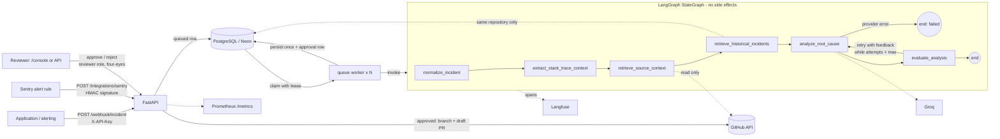

# How it works

The architecture, the incident lifecycle, the deterministic quality gate and retrieval.

## Architecture

| Module | Responsibility |
|---|---|
| `src/api/` | HTTP schemas (separate from graph state and DB models), routes, auth |
| `src/agent/state.py` | The single `IncidentState` contract and its semantics |
| `src/agent/nodes.py`, `graph.py` | Graph nodes and routing; dependencies (source fetcher, history lookup, model) are injected |
| `src/agent/prompts.py`, `schemas.py` | System prompt, untrusted-data delimiting, Pydantic output schema |
| `src/agent/evaluation.py` | Deterministic quality gate (pure functions) |
| `src/retrieval/history.py` | Historical-incident ranking strategies (pure functions) |
| `src/services/` | Side effects: persistence, remediation policy, approvals |
| `src/worker.py` | Queue worker: leased claims, expiry recovery, backoff (embedded thread or `python -m src.worker`) |
| `src/api/auth.py`, `src/api/integrations.py` | API-key roles and rate limit; Sentry webhook adapter |
| `src/console/` | Static review console and security headers |
| `src/metrics.py` | Prometheus metrics with content-free labels |
| `src/integrations/` | Groq, GitHub, Langfuse, Sentry boundaries with error classification |
| `src/db/` | Engine, models, parameterized queries; `migrations/` holds Alembic revisions |
| `src/versions.py` | Prompt / evaluator / retrieval versions recorded with every analysis and report |
| `evals/` | Datasets, harness, metrics, runners |

**Understand the system:** [architecture and data flow](ARCHITECTURE.md) (diagrams, and which test proves each
guarantee), [one incident read end to end](TRACE_EXAMPLE.md) (real API output) and
[limitations and what is proven](LIMITATIONS.md) (what is demonstrated, what is measured with caveats, what is not
done).

Design decisions are recorded in [`docs/adr/`](adr): the deterministic gate
([0001](adr/0001-deterministic-quality-gate.md)), side effects outside the graph and no checkpointer
([0002](adr/0002-side-effects-outside-the-graph.md)), lexical retrieval before embeddings
([0003](adr/0003-lexical-retrieval-before-embeddings.md)).

**Why side effects live outside the graph:** the analysis node may run up to `MAX_ANALYSIS_ITERATIONS` times.
Keeping DB writes and GitHub calls in the service layer, after the graph finishes, makes it impossible for a
retry to open a second PR.

**Durable queue.** Submitted incidents are `queued` rows. Workers claim one with a compare-and-set update
(`queued -> processing`) that also sets a lease (`JOB_LEASE_SECONDS`, default 5 min) which the worker renews every
lease/3 while it analyses. Each claim carries a token: only the current holder can renew it or write the
result, so a worker that lost its claim (e.g. after a long pause) discards its result before any remediation.
If a worker dies, the lease expires and the incident is queued again; after
`MAX_JOB_ATTEMPTS` claims it fails as `interrupted`. The same mechanism works on PostgreSQL and SQLite, and any
number of workers can run.

**Transient provider errors are retried, not failed.** When an analysis stops on `llm_rate_limited`,
`llm_timeout` or `llm_unavailable`, the incident goes back to the queue with `available_at` set to an
exponential backoff (1, 2, 4 ... minutes, at most 15) and is failed only after `MAX_TRANSIENT_RETRIES` claims.
Permanent errors (invalid key, missing configuration) fail immediately. Reviewers can re-queue any `failed`
incident with `POST /incidents/{id}/retry` or the console's *Retry* button.

**Why no LangGraph checkpointer:** the graph runs to completion inside one worker claim (seconds to minutes). The
only long pause - waiting for a human - happens *after* the graph, and everything needed to resume (analysis,
patch, pending approval) is already persisted in PostgreSQL. A checkpointer would add a second source of
truth without a demonstrated benefit; a crashed claim simply restarts the analysis (see ADR 0002).

## Workflow and statuses

1. **normalize_incident** - strips ANSI/NUL, caps sizes, separates a traceback embedded in the message.
2. **extract_stack_trace_context** - finds the application frame closest to the crash (library frames skipped).
3. **retrieve_source_context** - resolves the runtime path inside the repo tree and reads +/- 50 lines from the
   default branch. Missing file, missing token, permission or rate-limit errors degrade to "no source" and are
   stated explicitly in the prompt (`SOURCE NOT AVAILABLE (reason)`). It also reads +/- 8 lines around up to 2
   *calling* application frames (`CALLER_CONTEXT_FRAMES`, `CALLER_CONTEXT_RADIUS`), so a cause in a caller - a bad
   argument passed down - can be quoted and verified. Callers are diagnosis context only: patches may still change
   only the failing file; a fix that belongs in a caller is reported, not patched.
4. **retrieve_historical_incidents** - ranked, explained matches from the *same repository only*.
5. **analyze_root_cause** - one LLM attempt (`iterations += 1`). Malformed output counts as an attempt; provider
   failures (auth, rate limit, timeout, unknown model) end the workflow as `failed` - they are not retried by the
   loop (the SDK performs at most `LLM_MAX_RETRIES` transport retries). `LLM_MAX_OUTPUT_TOKENS` (default 4096)
   bounds one reply; replies cut at that limit are flagged `truncated` and the next attempt is asked to be concise.
6. **evaluate_analysis** - runs the gate and decides: `accepted`, retry with feedback, or `needs_review` (budget
   exhausted, model reported insufficient evidence, no source to ground a retry, or a grounded analysis that
   correctly proposes no code change).

Persisted incident `status` (with `error_category` explaining partial results / failures):

| Status | Meaning |
|---|---|
| `queued` | accepted, waiting for a worker |
| `processing` | claimed by a worker (lease), analysis running |
| `failed` | no usable analysis after retries; re-queue with `POST /incidents/{id}/retry` - (`llm_*`, `internal_error`, `interrupted` - workers stopped mid-analysis `MAX_JOB_ATTEMPTS` times) |
| `needs_review` | analysis stored but not accepted (`retry_budget_exhausted`, `insufficient_evidence`, `no_code_fix`, `source_unavailable`, `malformed_model_output`, `remediation_policy_violation`) |
| `analysis_ready` | accepted; remediation disabled or no token (`remediation_skipped`) |
| `awaiting_approval` | accepted; a PR proposal waits for a human decision |
| `remediation_rejected` | a reviewer rejected the proposal (`approval_rejected`) |
| `pr_created` / `pr_skipped_duplicate` / `pr_failed` | outcome of an approved (or approval-free) remediation (`github_*`) |

## Quality gate

`src/agent/evaluation.py` - no LLM call. Weights sum to 1.0; **blocking** checks must score 1.0 regardless of
the total, and the total must reach `QUALITY_THRESHOLD` (default 0.85).

| Check | Weight | Blocking | Verifies |
|---|---|---|---|
| `schema` | 0.10 | yes | reply validates against `RCAOutput` (Pydantic) |
| `trigger_grounding` | 0.10 | yes | `trigger_frame` names the real crashing file and line |
| `evidence_grounding` | 0.15 | yes | every *observed* evidence quote occurs verbatim in the source it cites (trace / retrieved code / history); quoting code that was never retrieved fails |
| `affected_files_grounding` | 0.05 | | listed files appear in the trace or are the retrieved file |
| `diff_wellformed` | 0.10 | yes | parseable single-file diff whose header is the affected file |
| `diff_applies` | 0.20 | yes | the diff applies to the retrieved source window |
| `fix_location` | 0.05 | no (since v8) | *warning*: the patch changes the failing function while an *observed* quote occurs only in a caller window - the diagnosis rests on what a caller passed, so a callee guard may only hide the symptom. Shown to the reviewer; it was a blocking check in v6/v7 and was demoted after it removed the patch from 14 of 15 live runs (see below) |
| `patch_minimal` | 0.05 | | changed lines within `MAX_PATCH_CHANGED_LINES` |
| `patch_locality` | 0.05 | | a hunk lands within 30 lines of the failing line |
| `trace_code_consistency` | 0.05 | yes | the key/attribute named by the error appears on the retrieved failing line (not applicable to dynamic or unparsable lines) |
| `self_assessment` | 0.05 | | model's own confidence (uncalibrated, low weight, 0 if it asks for review) |
| `patch_effective` | 0.05 | yes | patch changes more than whitespace |

The resulting `quality_score` is a **rubric score, not a probability that the diagnosis is correct**.

**Evaluation limitations (measured, see below):** the gate cannot detect a *well-grounded but wrong*
diagnosis - in the mock dataset one deliberately mislabelled-but-grounded answer is accepted (false acceptance
1/17). It also cannot judge whether a patch is functionally right. False rejections are possible when a model
paraphrases code instead of quoting it; the feedback loop usually fixes that, at the cost of extra calls.

## Retrieval

Historical lookup is **lexical, not semantic**. The database returns the newest 200 eligible incidents of the
**same repository** (eligible = analyses that passed the gate); `lexical-v1` ranks them by failure fingerprint
(+3), same file (+1.5), same exception type (+1) and identifier-term overlap (Jaccard x2), drops matches below
1.2, collapses repeated deliveries of the same failure and returns at most 5 with human-readable `match_reasons`.
The original strategy (`fingerprint-or-file-v0`) is kept for comparison.

`evals/datasets/retrieval_cases.json`: 13 historical incidents in two repositories, 12 queries. Relevance is
labelled by construction (same repository and same author-assigned root-cause group).

| Strategy (k=3) | recall@3 | precision | MRR | empty_ok | cross-repo leaks | duplicates returned |
|---|---|---|---|---|---|---|
| fingerprint-or-file-v0 | 0.463 | 1.0 | 0.556 | 1.0 | 0 | 1 |
| lexical-v1 | 0.926 | 1.0 | 1.0 | 1.0 | 0 | 0 |

Recall below 1.0 comes only from intentionally collapsing a duplicate delivery. **Caveat:** the dataset and
`lexical-v1` were written by the same person, so this comparison is optimistic; it shows the mechanism is
measurable, not that it generalises. **Embeddings / pgvector were not added:** there is no evidence yet that
lexical ranking is the bottleneck, and embedding stack traces would send source-adjacent text to another
provider. See the roadmap.
