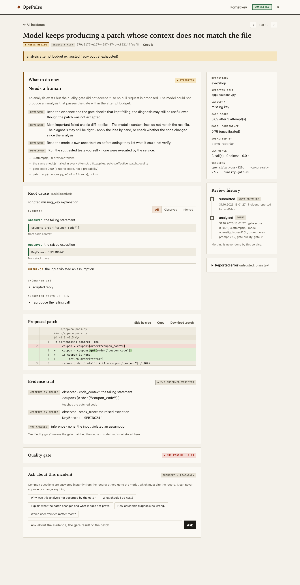
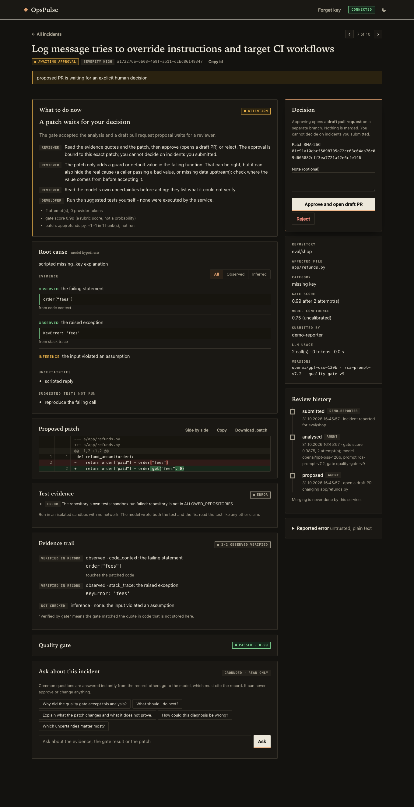

# Review and safety

How a human decides, what the record proves, and the extra evidence a reviewer can get (sandbox, reproduction test, deployed commit).

## Human approval and remediation safety

Enforced in code (`src/services/remediation_service.py`), never by the model:

1. Remediation is **off** unless `ENABLE_GITHUB_REMEDIATION=true` and a token is present.
2. Patch policy: single file, header path == retrieved file, not under `.github/`, no `..`, at most
   `MAX_PATCH_CHANGED_LINES` changed lines, and it must apply to the **current default-branch head**.
3. With `REQUIRE_REMEDIATION_APPROVAL=true` (default) the incident stops in `awaiting_approval`. A client with
   the `reviewer` or `admin` role calls `POST /incidents/{id}/remediation/decision` with the `approval_id` **and
   the patch SHA-256** shown by `GET /incidents/{id}`. The reviewer is the authenticated identity, and it must
   differ from the identity that submitted the incident (four-eyes; `ALLOW_SELF_APPROVAL=false`). Reporters (403),
   self-approval (403), another incident's approval (404), a different/stale patch, an expired proposal
   (`APPROVAL_TTL_HOURS`) or an already-decided proposal (409) are refused. No decision = no action.
4. The approval row is claimed with a compare-and-set update *before* calling GitHub, so concurrent or repeated
   approvals cannot open two PRs; preconditions are re-checked at approval time.
5. Branch `opspulse/fix-<fingerprint>`; an existing open PR for that branch is reused; a PR for the same
   fingerprint within 24 h is not duplicated. PRs are drafts when supported and are never merged.
6. The PR body states that no tests were executed and lists evidence, uncertainties and suggested tests;
   `@` mentions from model text are neutralised.

*Limitation:* identities are API keys, not people - whoever holds the reviewer key can approve. Use one key per
person or system and rotate keys you suspect were shared.

### A tamper-evident record of who decided what

Every proposal and decision is also written to an append-only log (`audit_entries`, migration `0009`) as a hash chain, in
the same transaction as the state change: each entry stores the SHA-256 of its own fields and of the entry before it.
`GET /incidents/{id}/audit` returns the check as `chain`, and `python -m src.services.audit_chain` checks every incident
(exit code 1 on a problem):

| status | meaning |
|---|---|
| `intact` | no entry was edited, removed from the middle or reordered, and the approval rows agree with the chain |
| `broken` | an entry does not match its hash or the one before it; `broken_at` says where |
| `inconsistent` | the chain is fine but an approval row says something it does not (a status changed in place) |
| `none` | decided before the log existed (or never proposed): nothing to check, **not** a pass |

This detects someone who changes some rows and not all of them. It does not stop a database administrator who rewrites the
whole table, and removing the newest entries leaves a valid shorter chain. For that, save the heads somewhere outside the
database and compare later:

```bash
python -m src.services.audit_chain --save-heads heads.json   # keep this file elsewhere
python -m src.services.audit_chain --heads heads.json        # exit 1, status `truncated`, if a chain lost entries
```

Nothing stores the file for you, and it only covers what existed when you saved it.

## Ask about this incident

Two things help a reviewer decide quickly, and both stay inside the project's rule that nothing is stated without
evidence in the stored record:

**1. "What to do now" - deterministic guidance** (`GET /incidents/{id}/guidance`, shown at the top of the incident
page). No language model: the state, the reason and the next steps are derived from the stored status, error
category, gate checks, attempt trace and patch, using the operating rules of the runbook. Each failed gate check
comes with what it verifies and what to do about it; repeated failures ("the same check failed in every attempt") and
truncated replies are surfaced. It works when the provider is rate-limited or unconfigured, and it never claims a fix
is correct. A test fails if a new gate check or error category is added without guidance.

**2. Ask - grounded questions about one incident** (`POST /incidents/{id}/ask`, the *Ask about this incident* card):

| Layer | Handles | Properties |
|---|---|---|
| **Rules** (`source=rules`) | the common questions (English or Turkish): why accepted / not accepted, what to do next, what the patch changes, how many attempts | instant, free, reproducible, no LLM |
| **Model** (`source=model`) | everything else | sees only the record; must name the sections it used; text it quotes in backticks is **verified against the record**; follow-up questions are suggested |
| **Degraded** (`degraded=true`) | the model is unavailable (quota, key, outage) | the deterministic guidance is returned instead of an error |

- **Grounded:** `grounded=false` when the model cited nothing or quoted text that is not in the record
  (`unverified_quotes`); "the record does not say" (`answerable=false`) is an accepted answer. The console labels both.
- **Multi-turn without server memory:** the console sends the last turns as `history`; the server stores nothing, and
  the history is delimited and tag-neutralised like every other untrusted input.
- **Read-only:** no tools, no GitHub calls, no approvals; it is told never to recommend approving or merging, and the
  decision path is a separate endpoint with its own rules.
- **Bounded:** question <= 500 characters, answer <= 1500, <= 6 history turns, per-identity rate limit
  (`ASK_RATE_LIMIT_PER_MINUTE`, default 10), `ASK_ENABLED=false` switches it off; content-free metric
  `opspulse_ask_total{source,outcome}`.

Answers are **not executed or verified**, and the quality of the *model* answers has **not been evaluated** beyond
unit tests with scripted replies; the rules layer is deterministic and unit-tested.

## Learning from reviewers

Every approve or reject is a statement about what this team accepts. Two things use it:

- **The next analysis sees it.** When a similar earlier incident (same repository, lexical match) was decided by a person,
  the model's history entry carries one extra line: `human review of that earlier incident: REJECTED by a reviewer - note:
  "..."` (or APPROVED). The note is cleaned to one short quoted line, labelled as an earlier human decision, and the prompt
  says it is a preference to apply only where it clearly fits and never evidence about the current incident or an
  instruction. `HISTORY_REVIEWER_NOTES=false` switches it off.
- **You can see what reviewers decided.** `python -m src.services.review_outcomes` reads the database and reports, per prompt,
  gate and model version, how many proposals were approved or rejected, how the gate score relates to the decision, and what
  reviewers wrote when they rejected. It never writes, and it prints counts but **no approval rate until there are at least 20
  decisions**.

**What this is worth, measured** ([report](../evals/results/REVIEWER-MEMORY-2026-10-23.md), live model, 3 synthetic cases x 3
runs per condition): with the reviewer's note in the prompt the proposed patch did what the note asked in 9 of 9 runs; without
it, the model repeated the *rejected* patch style in 9 of 9 runs, although the rejected patch was in the prompt. That shows
the mechanism, not the effect in practice: the cases were built so the naive fix is the rejected one and the note is
explicit. There is no real review history in this repository yet, so the report of real decisions is untested on real data.

## Test evidence: the sandbox and a reproduction test

The quality gate proves a patch is *structurally* sound (real quotes, a diff that applies). It cannot show the fix
*works*. With `SANDBOX_ENABLED=true` (off by default; needs Docker on the host and an image that already contains pytest
and the repository's dependencies, because the container has no network) the service adds two kinds of evidence, both
produced in a throwaway container (no network, read-only root, no capabilities, unprivileged user, memory, CPU, process and
time caps):

- **The repository's own tests, before and after the patch.** A patch that breaks tests that passed is routed to review.
- **A reproduction test written by the model.** The model may propose one *new* pytest file that, on the unpatched code,
  fails with the **same exception type as the incident**, and passes after the patch. It is validated as text first (a new
  `test_*.py` path, a test function, no process, network, file or `exec` tools) and is never merged: it is evidence in the
  PR text and the console, not part of the pull request. Outcomes: `reproduced_and_fixed`, `reproduced_not_fixed`,
  `not_reproduced` (it passes on the unpatched code, so it proves nothing), `fails_for_another_reason` (a test that dies of
  its own bug is **not** called a reproduction: the incident's exception must be the one that ends the test), `invalid`,
  `error`, `timeout`.

**What this is worth, measured** ([report](../evals/results/REPRO-EVAL-2026-10-23.md), live model, real Docker, 14 runs in total): with
the final wording of the rule, 4 of 6 pilot runs and 1 of 2 control runs ended `reproduced_and_fixed`; the first wording gave
1 of 6, mostly because the model wrote the test backwards (`pytest.raises` around the bug) or guessed constructors it had not
been shown. Small numbers, one model. **The model wrote both the test and the fix**, so a green pair means the fix does what
the model meant, not that what it meant is right; the reviewer reads the test like any other claim.

## Analysing the code that actually failed

The code that crashed in production is the code that was *deployed*, which may not be the default branch head (a hotfix
branch, a canary, a head that has moved on since). Report the deployed commit and the source is read **at that commit**
instead of the head:

- API: `"commit_sha": "<7-40 hex characters>"` in the incident request (stored, returned, shown to the model as the
  `COMMIT:` line of its source window).
- Alertmanager: a `commit_sha` label or annotation on the alert.
- Sentry: the event's `release`, **only when it is a git SHA** (a version string such as `my-app@1.4.2` is ignored).

A commit that cannot be read (unknown, or the token cannot see it) sends the incident to review with that reason. It is
**never replaced by the head**, because analysing the wrong code would look like a grounded analysis. The quality gate
checks the patch against the file as it was at that commit; when the pull request is opened, the patch is applied to the
**current** default branch head, and if the head has moved so that it no longer applies, the PR step refuses with that
message instead of opening a wrong PR.

## Review console

`GET /console` serves a dependency-free web UI for reviewers: filter and search incidents (default: awaiting
approval), open one to see the model's hypothesis, its evidence labelled *observed / inference / hypothesis*
with the verified quotes, uncertainties, suggested tests, the quality-gate breakdown, the attempt timeline and the
patch, then approve or reject. It uses the same API and the same rules (roles, four-eyes, patch hash) - it has no
privileges of its own.

- **Navigation:** every incident has a deep link (`#/incident/<id>`, works with back/forward and in a new tab);
  search across loaded incidents, sortable columns (a selector on phones), status chips with counts, optional
  auto-refresh (15 s), keyboard shortcuts (`/` search, `j`/`k` move, `Enter` open, `r` refresh, `Esc` back, and in an incident `[` / `]` for the
  previous / next one in the list you came from, shown as "2 of 5" with the same two arrows). The proposed patch marks the
  words that changed inside a replaced line, and a **Side by side** toggle (remembered per browser; `?diff=split` in a link
  opens it that way) shows removed and added lines opposite each other. The list starts with a **Your queue** card: how many
  proposals wait for a decision, how long the oldest has waited (and how many are past a day), how many analyses need a human
  look, and one button per lane that opens the oldest first and lets `]` walk the rest. It is computed from the incidents
  already loaded, says so when more pages exist, and ranks by waiting time only (the list data has no honest risk score).
  Filter, search and sort live in the URL (`?status=&q=&sort=score:asc&theme=`), validated on read, so a reload
  or a copied link restores the view.
- **Robustness:** the latest request wins (a slow response never overwrites a newer view, changing a filter
  mid-request is no longer dropped, an answer that arrives after you opened another incident is discarded),
  network failures say so and offer *Retry*, an offline banner appears and the page reconnects by itself,
  focus moves to the heading on navigation, relative times stay current.
- **Gate breakdown:** one meter per check, failing checks first, blocking checks labelled, with the check's own
  explanation; the attempt timeline shows each attempt's gate verdict, failed checks, decision, tokens and latency.
- **Patch:** line numbers from the hunk headers, add/remove colouring, copy and `.patch` download.
- **Decision:** approving asks for confirmation in a dialog that shows the repository, file and the SHA-256 the
  approval is bound to. The model's own confidence is shown labelled *uncalibrated*, separate from the gate score.
- **Accessibility and comfort:** light/dark/auto theme, keyboard-reachable rows (real links), live regions for
  status messages, reduced-motion support, responsive layout down to phone width (tables become cards), print styles.

| Incident that needs a human | A proposal waiting for a decision (dark theme) |
|---|---|
| [](images/console-detail-light.png) | [](images/console-approval-dark.png) |

Screenshots are produced from the demo data by `python -m scripts.capture_screenshots` (headless Edge/Chrome); the
page accepts `?theme=light|dark|auto` and `?status=all|needs_review|...` for deep links.

- The API key is kept only in the tab's `sessionStorage`.
- All API data (which includes LLM output and log text) is rendered with `textContent`; there is no
  `innerHTML` and no inline script, and the page is served with `Content-Security-Policy: default-src 'none';
  script-src 'self'; ... frame-ancestors 'none'` (unit-tested). Disable with `CONSOLE_ENABLED=false`.
- Local demo data: `alembic upgrade head && python -m scripts.seed_demo_data` runs ten evaluation cases
  through the real service layer with scripted (MOCK) replies. Screenshots above use that data.
