# Setup and usage

Install, configure, call the API and the command line, run the tests and the demo.

## Setup

Requirements: Python 3.11+, a PostgreSQL database (Neon works), a Groq API key. GitHub and Langfuse are optional.

**Windows (PowerShell)**

```powershell
py -3.11 -m venv .venv
.\.venv\Scripts\Activate.ps1
pip install -r requirements-dev.txt
Copy-Item .env.example .env   # then edit .env
alembic upgrade head
uvicorn src.main:app --reload --port 8000
```

**macOS / Linux (bash)**

```bash
python3.11 -m venv .venv
source .venv/bin/activate
pip install -r requirements-dev.txt
cp .env.example .env   # then edit .env
alembic upgrade head
uvicorn src.main:app --reload --port 8000
```

`.env.example` contains placeholders only. Required: `DATABASE_URL`, `API_KEYS` (or the legacy `API_KEY`),
`ALLOWED_REPOSITORIES`, `GROQ_API_KEY`. Without any key the incident endpoints return 503 (set
`ALLOW_UNAUTHENTICATED=true` only for local experiments).

**API keys and roles.** Create one key per client; only its SHA-256 goes into the configuration:

```bash
python -m scripts.make_api_key alertmanager reporter   # may submit and read incidents
python -m scripts.make_api_key alice reviewer          # may also approve/reject remediation
```

Append the printed `name:role:sha256` entries to `API_KEYS` (comma-separated) and hand each key to its client.

**GitHub token scopes:** *Contents: Read* for analysis; additionally *Contents: Read & write* and
*Pull requests: Read & write* for remediation - fine-grained and limited to the allow-listed repositories.

**Database migrations.** The schema is owned by Alembic; the app never creates tables implicitly.
A database created by the first release (before Alembic): run `alembic stamp 0001` once, then `alembic upgrade head`.

**Docker**

```bash
docker compose up --build                    # API on :8000, one queue worker, local PostgreSQL
docker compose up --build --scale worker=3   # more analysis throughput
```

The API container applies migrations on start; workers (`python -m src.worker`) only poll the queue. Without
Compose, the API runs an embedded worker thread (`EMBEDDED_WORKER=true`, default).

For Neon, remove the `db` service and set `DATABASE_URL` in `.env`.

## Command line

A standard-library client for a running API (no extra dependencies):

```bash
export OPSPULSE_URL=http://127.0.0.1:8000 OPSPULSE_API_KEY=<key>
python -m src.cli submit --repo owner/repo --error "KeyError: 'x'" --trace-file trace.txt --wait
python -m src.cli list --status awaiting_approval
python -m src.cli show <incident-id> --patch
python -m src.cli guidance <incident-id>        # state, reason and next steps (no LLM)
python -m src.cli ask <incident-id> "Why was this not accepted?"
python -m src.cli health
python -m src.cli demo                          # console on a throwaway demo database
```

`--json` prints the raw response for scripting; exit codes are 0 ok, 1 the API refused or failed, 2 usage or
connection. There is deliberately **no `approve` command**: the decision stays with a reviewer in the console (or
the decision endpoint), where the evidence and the patch are in front of them.

## API

`GET /healthz` (liveness, public) · `GET /readyz` (database check, public, no details) · `GET /metrics`
(Prometheus; public unless `METRICS_ENABLED=false`) · `GET /incidents?status=awaiting_approval&limit=20`
(newest first, keyset `cursor` pagination) · interactive docs at `/docs` · a generated
[API reference](API.md) (kept in sync with the code by a test).

```bash
curl -X POST "http://localhost:8000/webhook/incident?wait=true" \
  -H "X-API-Key: $API_KEY" -H "Content-Type: application/json" \
  -d '{"repo_name": "your-org/your-repo",
       "error_message": "TypeError: '\''NoneType'\'' object is not subscriptable",
       "stack_trace": "Traceback (most recent call last):\n  File \"/app/src/app.py\", line 6, in load_user\n    name = profile[\"name\"]\nTypeError: '\''NoneType'\'' object is not subscriptable"}'
```

Without `wait=true` the endpoint returns `202 {"incident_id": "...", "status": "queued"}`; a worker picks it up; poll
`GET /incidents/{id}`. Shape of a result (abridged; `<...>` are placeholders, not measured values):

```json
{
  "incident_id": "6f1c...", "status": "awaiting_approval", "error_category": null,
  "status_reason": "proposed PR is waiting for an explicit human decision",
  "quality_score": "<0..1>", "iterations": 1, "affected_file": "src/app.py",
  "analysis": {"root_cause_category": "null_reference", "evidence": ["..."], "uncertainties": ["..."],
               "tests_to_run": ["..."], "evaluation": {"quality_gate_passed": true, "checks": {"...": "..."}},
               "attempts": [{"iteration": 1, "latency_ms": "<ms>", "input_tokens": "<n>", "output_tokens": "<n>"}]},
  "suggested_patch": "--- a/src/app.py\n+++ b/src/app.py\n...",
  "pending_approval": {"approval_id": "b2e9...", "patch_sha256": "4be1...", "target_file": "src/app.py",
                       "action": "open_pull_request", "expires_at": "..."}
}
```

```bash
curl -X POST "http://localhost:8000/incidents/<incident_id>/remediation/decision" \
  -H "X-API-Key: $REVIEWER_KEY" -H "Content-Type: application/json" \
  -d '{"approval_id": "<approval_id>", "patch_sha256": "<patch_sha256>", "decision": "approve", "note": "looks right"}'
```

Errors always look like `{"error": {"code": "...", "message": "..."}}` and never echo submitted values,
stack traces or connection strings. Re-sending a request with the same `incident_id` returns the stored incident
(200) without re-running the analysis.

## Testing and CI

```bash
pytest                               # 922 offline tests (SQLite, fakes for Groq/GitHub/Langfuse; includes property-based tests)
pytest --cov=src --cov=evals         # coverage (89% total when last measured, 2026-11-12; CI enforces a floor, see ci.yml)
python -m evals.ask_eval --mode mock # incident-assistant evaluation (offline)
ruff check src tests evals scripts migrations && ruff format --check src tests evals scripts migrations
mypy                                 # src/
RUN_LIVE_TESTS=1 pytest tests/integration -v   # opt-in, uses your real .env
```

Unit tests cover request validation and limits, auth (missing/wrong key, fail-closed), allow-list, idempotent
redelivery, stack-trace parsing, diff parsing/application (including multi-file smuggling), the quality gate
(passing and failing cases, fabricated quotes, unretrieved sources), schema validation, prompt-tag injection,
graph termination and retry budgets, provider-error classification, DB outages (503, never false success),
GitHub failures, approval binding/staleness/expiry/double-approval, retrieval ranking and repository isolation,
Alembic migrations vs. models, Langfuse enabled/disabled/broken, log redaction, the evaluation metrics, roles and
the four-eyes rule, rate limiting, queue claims/lease expiry/worker resilience, Sentry signatures and payload
translation, listing/pagination, Prometheus labels, and the console's CSP and absence of unsafe DOM sinks.

`.github/workflows/ci.yml` (no secrets, `contents: read`) has five jobs:

- **python-versions** - the unit tests on Python 3.12 and 3.13 (the image uses 3.11);
- **quality** - ruff, format check, mypy, import smoke test, unit tests with coverage, mock evaluation of five
  datasets against committed baselines (fails on any quality regression), retrieval evaluation (fails on any cross-repository leak) and the sandboxed demo;
- **postgres** - Alembic upgrade/downgrade/upgrade round trip, `alembic check` (models == migrated schema) and
  the unit tests against a PostgreSQL 16 service container;
- **docker** - validates the Compose file and the Prometheus alert rules, builds the image, and runs an
  end-to-end smoke test of the Compose stack (`scripts/compose_smoke.sh`): an incident submitted to the API
  is processed by the separate worker container against PostgreSQL;
- **sandbox-docker** - the opt-in sandbox tests (escape attempts, a real fix, a regression, the reproduction test) against
  a real Docker daemon on a Linux runner.

The first CI run on GitHub caught a dependency that a stale local virtualenv had hidden (see CHANGELOG); the
workflow has run green on GitHub since. Contributor workflow: [CONTRIBUTING.md](../CONTRIBUTING.md); security:
[SECURITY.md](../SECURITY.md).

## Demo

**The whole flow, checked end to end** (no Docker, keys or GitHub; scripted model, GitHub stubbed):

```bash
python -m scripts.e2e_flow     # 25 checks: alert -> analysis -> review -> one draft PR -> the patch fixes the service
```

It runs a real crash of `examples/demo_service`, sends it through the Alertmanager webhook, the queue worker and the
quality gate, shows that nothing reaches GitHub until a reviewer decides, that a reporter and a stale patch hash are
refused, that a repeated approval creates no second PR, and that the review history is complete. It is also a unit
test and a CI step. It proves the plumbing and the safety rules, not the model's quality (the evaluations measure that).

**The console in one command** (no Docker, PostgreSQL or API keys; a throwaway SQLite database, ten scripted cases):

```bash
python -m scripts.demo_console          # then open http://127.0.0.1:8000/console , API key: demo-key
```

The LLM is switched off in this mode, so the *What to do now* card and the rule-based answers work, and model
questions degrade to the deterministic guidance.



*Recording of the mock run (regenerate with `python -m scripts.render_demo_svg`).*

```bash
python -m scripts.demo          # scripted (MOCK) model reply
python -m scripts.demo --live   # real Groq model
```

`examples/demo_service/` contains a small inventory module with a real bug (unknown SKU -> `None >= int`) and a
test that fails. The demo copies it to a temp directory, runs its tests (1 failed, 2 passed), reproduces the crash
in a subprocess, runs the OpsPulse graph on the real traceback, applies an accepted patch to the copy with the
pure-Python diff applier (generated code is never executed in-process) and re-runs the tests in a subprocess.
Local mock run: 3 passed after the patch. In mock mode the analysis is scripted, so this demonstrates the
pipeline, gate and sandboxed verification - **not** the model's ability. PR creation is not part of the demo.

**Live run** (`openai/gpt-oss-120b`, 2026-10-10, [report](../evals/results/demo-live-2026-10-10.json)): accepted on the
first attempt (quality score 0.99), category `missing_key`, root cause "the SKU is absent from `STOCK`, so
`available()` returns `None`", patch `STOCK.get(sku)` -> `STOCK.get(sku, 0)`; tests after the patch: 3 passed.
One run of one bug - it shows the loop works end to end, not that it generalises.

## Documentation site and releases

The README, runbook, ADRs and changelog are also published as a searchable site (MkDocs Material), assembled from
these same files by `python -m scripts.build_docs` and built by the `Docs` workflow (warnings are errors). To turn
the site on: *Settings -> Pages -> Source: GitHub Actions*, then add the repository variable `PAGES_ENABLED=true`.
Pushing a tag such as `v1.2.0` runs the `Release` workflow, which checks the tag against `pyproject.toml` and
publishes a GitHub Release using that version's section of `CHANGELOG.md` as its notes.
